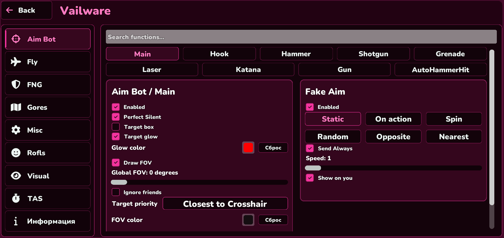

# VailWare Free

**Кастомный Windows-клиент на базе DDNet с фирменным интерфейсом.**

## О проекте

В этом репозитории публикуются описание и готовые сборки VailWare Free. Исходный код VailWare здесь не распространяется.

## Установка

1. Открой раздел **Releases** справа на странице GitHub.
2. Скачай `VailWare-Free-Client-2026-10-10.zip`.
3. Распакуй архив целиком в отдельную папку.
4. Запусти `Vailware-Free.exe`.

Не запускай программу прямо из ZIP: клиенту нужны папка `data` и DLL-файлы рядом с EXE.

## Состав релиза

- `Vailware-Free.exe` — игровой клиент;
- `data/` — игровые ресурсы и интерфейс;
- DLL-файлы — зависимости клиента;
- лицензионные уведомления DDNet и сторонних компонентов.

## Важно

VailWare основан на DDNet и включает сторонние компоненты. Их уведомления и лицензии находятся в `THIRD_PARTY_NOTICES.txt` и внутри архива релиза.

Используй дополнительные игровые функции только на серверах, где они разрешены правилами.
